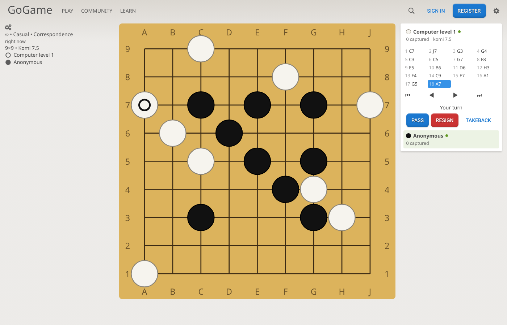
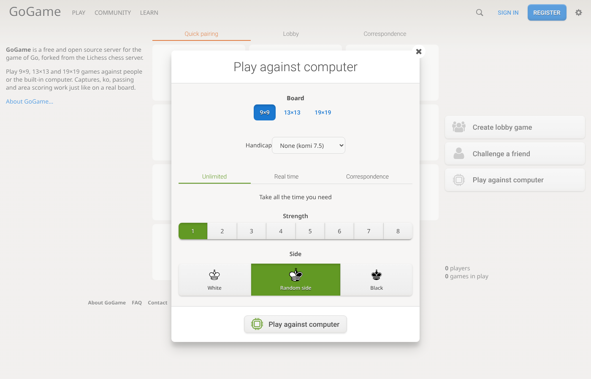
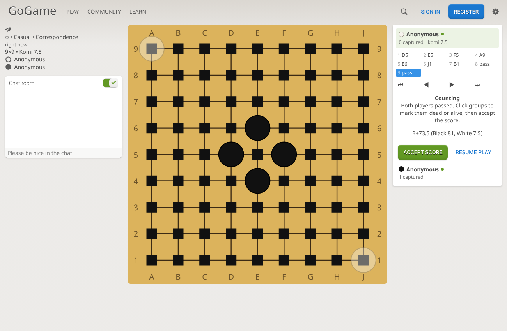

# GoGame — a Go server forked from Lichess

GoGame is a free, open source server for the game of **Go** (Baduk, Weiqi), built by
forking [lila](https://github.com/lichess-org/lila), the server behind
[lichess.org](https://lichess.org), and its websocket server
[lila-ws](https://github.com/lichess-org/lila-ws), and replacing chess with Go.

It keeps Lichess's architecture and platform features — accounts, ratings, a realtime
lobby with seeks and quick pairing, friend challenges, rematches, chat, takebacks,
clocks, correspondence games, notifications, messages — and swaps the game itself.

> This branch replaces the earlier Flutter app that lives on `main` / `development`.



## What you can do

- Play **9×9, 13×13 and 19×19** games, with an optional **handicap** (2–9 stones, komi 0.5)
- Play against people: lobby seeks, quick-pairing pools (three per board size), or a challenge link
- Clocks are Fischer (main time plus an increment per move), with times sized for Go:
  quick pairing offers 1+5, 3+5 and 5+10 on 9×9, 5+10, 10+10 and 15+15 on 13×13, and
  10+15, 20+20 and 30+30 on 19×19 (`modules/pool/src/main/PoolList.scala`). Byo-yomi is
  not implemented yet
- Play against the computer, levels 1–8, played by **[KataGo](https://github.com/lightvector/KataGo)**:
  levels 1–7 imitate human players from 20 kyu to 9 dan, level 8 is full strength. One
  KataGo analysis engine serves every game at once, so many people can play it together
- Real time, correspondence, or unlimited games, Glicko-2 ratings per speed
- Pass, resign, abort, takebacks, rematch
- **Counting phase** after two passes: the server proposes dead stones, players click
  groups to toggle them, both accept, and the game is scored with **area (Chinese) rules**
- Review finished games move by move, and **download them as SGF**
- A signup captcha that is a small "capture the stones" Go problem

| New game dialog | Counting after two passes |
| --- | --- |
|  |  |

## How the fork is organised

| Path | What it is |
| --- | --- |
| `modules/goban` | **New.** The Go rules engine: board, captures, suicide, positional superko, handicap placement, area scoring, SGF read/write. Pure Scala, unit tested. The computer opponent (KataGo's analysis engine) is in `modules/round` (`AiEngine`, `KataGo`). |
| `modules/core`, `game`, `round`, `lobby`, `setup`, `challenge`, `pool` | Lichess modules converted from chess to Go. `core.Game` now wraps `goban.Game`; games are stored as SGF move keys plus board size, komi, handicap and dead stones. |
| `modules/*` (others) | Lichess platform modules kept as-is or lightly trimmed: users, security, OAuth, prefs, ratings, chat, messages, notifications, relations, reports, playbans, i18n, web. |
| `app/` | The Play application: controllers, views and routes for the kept features. |
| `ws/` | lila-ws, adapted to forward Go moves, passes and scoring actions, and to push Go boards to live mini games. |
| `ui/round` | **New.** The game page: an SVG goban, move list and replay, clocks and controls, written with snabbdom. |
| `ui/lobby`, `ui/lib`, `ui/site`, `ui/bits` | Lichess's front end, converted to Go (setup dialog, mini boards, captcha). |

Removed from Lichess because they are chess specific: puzzles, studies, the analysis
board and Stockfish/fishnet, opening explorer, insights, tutor, learn and practice,
tournaments/swiss/simuls (they depend on chess pairing and display code), broadcasts,
TV, forums, teams, blogs, streamers, coaches, classes and the chess board editor.
Links that pointed to them now go to the home page (`lila.ui.deadLink` in the code
marks them).

### How a move travels

```
browser ── websocket ──> lila-ws ── redis ──> lila (round module)
   ^                                              │ goban.Game.apply(move)
   └──────── move event (board, captures, clock) ─┘
```

The client sends SGF coordinates (`"pd"`) or `"pass"`. The server is authoritative;
the client also checks legality (occupied, suicide, ko) to avoid sending illegal moves.
After two consecutive passes, `round` enters the counting phase, asks KataGo which stones
are dead, and finishes the game when both players accept the score.

## Running it locally

Requirements: **Java 21**, **sbt**, **Node.js 24.20+** with **pnpm 12**, **MongoDB**
(7.x works) and **Redis**.

1. Start MongoDB on `localhost:27017` and Redis on `localhost:6379`. The data goes in the
   `gogame` database. Optionally, create its indexes once (faster queries):

   ```bash
   mongosh gogame bin/mongodb/indexes-gogame.js
   ```

2. Install KataGo, the computer opponent, into `katago/` (about 300 MB of downloads):

   ```bash
   bin/setup-katago
   ```

   Without it everything else works, but the computer doesn't move, and counting starts
   with no dead stones marked.
3. Build the front end:

   ```bash
   ./ui/build
   ```

4. Start lila (HTTP on port 9663):

   ```bash
   ./lila.sh run
   ```

5. In another terminal, start lila-ws (websockets on port 9664):

   ```bash
   cd ws && sbt run
   ```

6. Open <http://localhost:9663>.

### Upgrading from the "lichess" database

Earlier versions of GoGame stored everything in a database named `lichess`. To keep your
accounts and games, stop lila and lila-ws, then move them into `gogame`:

```bash
mongosh bin/mongodb/rename-to-gogame.js
```

It moves every collection with its indexes, and can be run again safely. Without it the
servers start on an empty `gogame` database, and the old data stays in `lichess`.

### Playing from other devices

To open the site from a phone, a tablet or another computer on the same network, start both
servers with `GOGAME_HOST` set to this computer's address on the network (for example
`192.168.1.20`; see `ip addr` on Linux, `ipconfig getifaddr en0` on macOS):

```bash
GOGAME_HOST=192.168.1.20 ./lila.sh run
```

```bash
cd ws && GOGAME_HOST=192.168.1.20 sbt run
```

Then open <http://192.168.1.20:9663> on the other device. The variable sets the address the
pages and websockets use (`net.host` in `conf/base.conf`, `host` in
`ws/src/main/resources/application.conf`). If you set `net.domain` or `net.socket.domains` in
`conf/application.conf`, remove them: they would override it. Your firewall must let the
other device reach ports 9663 and 9664.

### Testing multiplayer and phones

Each player needs their own cookies: two tabs of one browser are the *same* guest. Use two
browsers or a private window, or one account per player. For repeatable checks,
[`test/e2e`](test/e2e/README.md) has Playwright scripts that play as independent players
(guests and accounts: captures, reload, takeback, counting, resignation, rematch) and on
emulated phones and tablets (layout, playing by tapping, phone against desktop).

### The computer opponent: KataGo

The computer is [KataGo](https://github.com/lightvector/KataGo), on by default
(`round.ai.katago` in `conf/base.conf`). `bin/setup-katago` installs it into `katago/`
(ignored by git):

- `katago/katago`: KataGo 1.15.3. On Linux x64 the script downloads the official CPU build,
  using `eigenavx2` when the processor supports it, and adds the older system libraries
  it needs on recent Ubuntu. Set `KATAGO_BACKEND=opencl` or `cuda` for a GPU build; on macOS
  it uses Homebrew.
- `katago/model.bin.gz`: the main network, for full strength and for counting.
- `katago/human.bin.gz`: the human-style network, which plays like a human of a given rank.

The engine settings are in `conf/katago.cfg`. The levels are set in `base.conf`:

| Level | 1 | 2 | 3 | 4 | 5 | 6 | 7 | 8 |
| --- | --- | --- | --- | --- | --- | --- | --- | --- |
| Plays like | 20k | 15k | 10k | 5k | 1k | 3d | 9d | full strength |

In a game, the computer's name reads **KataGo 10k · level 3** and so on.

The server starts one KataGo **analysis engine** (`katago analysis`, in
`modules/round/src/main/KataGo.scala`) for all games. For each computer move it sends the
whole position as one JSON query, with the server's rules (area scoring, positional superko,
no suicide) and the level's rank and search size; answers come back in any order, matched
by id. KataGo searches several positions at the same time (`numAnalysisThreads` in
`conf/katago.cfg`) and batches their network evaluations, so many people can play the
computer together; raise it with more cores or a GPU.

The server then picks the move from KataGo's answer. At a rank, it draws a move from the
human-style network's policy for that rank, and passes only when KataGo's own best move is a
pass. At full strength, it draws among the moves KataGo's search liked best. When counting
starts, KataGo's ownership estimate gives the dead stones.

There is no other engine. If KataGo is missing, crashes or takes longer than `timeout`, the
computer doesn't move; the server asks again shortly after (and restarts KataGo if it stopped
answering), and counting starts with no stones marked dead.

Speed, on a 4-core CPU with the default settings: levels 1–7 answer in 1 to 2 seconds;
level 8 takes a few seconds on 19×19. With a GPU build you can raise level 8's `visits` for
a much stronger engine, and `numAnalysisThreads` to serve more games at once.

#### Checking that KataGo is playing

1. `bin/setup-katago` ends with a test query: it prints `KataGo works`.
2. Restart lila. Its log prints `AI engine ready: KataGo 1.15.3` once the networks are loaded
   (a few seconds). If it prints `AI engine failed to start` instead, run
   `bin/setup-katago` again; the message ends with KataGo's last error lines.
3. Play the computer: its name in the game reads **KataGo … · level N**. Hover over it to
   see the rank it imitates.
4. With `logAllRequests = true` and `logAllResponses = true` in `conf/katago.cfg`, every
   query and answer is written to `katago/gtp_logs/`.

Tests:

```bash
./lila.sh test           # server, including the goban and KataGo client tests
KATAGO_COMMAND="$PWD/katago/katago analysis -model $PWD/katago/model.bin.gz -human-model $PWD/katago/human.bin.gz -config $PWD/conf/katago.cfg" \
  ./lila.sh "round/testOnly lila.round.KataGoTest"   # also run the real-KataGo test
./ui/build --tsc         # front-end type checking
```

## Before you run it publicly

- The Terms of Service (`/terms-of-service`) and Privacy policy (`/privacy`) pages are plain
  starting points written for this server (`modules/web/src/main/ui/FaqUi.scala`). Review and
  adapt them to your own service and its jurisdiction.
- The account deletion page still carries Lichess's GDPR explanation
  (`modules/pref/src/main/ui/AccountPages.scala`): replace it with your own.

### Production setup

On a fresh **Ubuntu 24.04** server, `bin/install-server` does everything: it installs the
dependencies, builds both servers, installs KataGo, generates the configuration below,
protects MongoDB and Redis with passwords, and sets up the services (`deploy/systemd`),
nginx, HTTPS, the firewall and nightly database backups:

```bash
sudo /opt/gogame/bin/install-server go.example.com --email you@example.com
```

For AWS (EC2, Route 53, SES email, S3 backups) follow [deploy/aws/README.md](deploy/aws/README.md).

To set up the configuration by hand instead, run once on the server:

```bash
bin/setup-production go.example.com
```

It writes, with new random secrets, all ignored by git:

- `conf/secrets.conf`: lila's production settings, included by `conf/application.conf`.
  Back it up: if `user.password.bpass.secret` is lost or changed, no password works anymore.
- `ws/production.conf`: lila-ws's settings; start lila-ws with
  `-Dconfig.file=ws/production.conf`.
- `conf/nginx-gogame.conf`: the nginx site for `go.example.com` and `ws.go.example.com`.

It also prints the commands that give MongoDB and Redis their generated passwords.

A few values come from outside services:

| What | Where to get it |
| --- | --- |
| Domain names | Any registrar. Point `go.example.com` and `ws.go.example.com` (DNS `A` records) at the server. |
| HTTPS certificates | Free from Let's Encrypt: `sudo certbot --nginx --redirect -d go.example.com -d ws.go.example.com` after installing the nginx site. Renewed automatically. |
| SMTP settings (`mailer.primary`) | An email provider such as Brevo, Mailgun, Postmark or Amazon SES. Add your domain there, publish the DNS records it gives you (SPF, DKIM), and create SMTP credentials: host, port, user, password. Then set `mock = false` and `security.email_confirm.enabled = true`. |
| Turnstile keys (`turnstile`), optional | Cloudflare dashboard, Turnstile, Add widget, with your domain: it gives a site key and a secret key. Free, and the domain does not need to be on Cloudflare. |
| GeoIP database (`geoip.file`), optional | A free MaxMind account, then download GeoLite2-City (`.mmdb`). |

The leaked-password check, the disposable email list and the Tor list need no key.

## License and credits

GoGame is derived from **lila** and **lila-ws** by the Lichess authors
(Copyright © 2012–2026 the lila authors), and is distributed under the
**GNU Affero General Public License v3 or later**, like the originals. See
[`LICENSE`](LICENSE) and [`COPYING.md`](COPYING.md) for the full terms and for the
fonts and assets that carry their own licenses. Because this is AGPL software, if you
run a modified version as a network service you must offer its source to your users.

GoGame is not affiliated with or endorsed by Lichess. The Lichess name and logo are
not used for this project.

The first commit on this branch imports lila at
`2e3e641c32b361c113e696cee34f9fddefef6727` and lila-ws at
`95f3f97121825c5bb5b8d5c006a47300bc05050c` unchanged (minus Lichess's Git LFS assets),
so every later change can be reviewed against upstream.

**AI disclosure:** the conversion to Go (the `goban` engine, the module and UI changes,
this README) was written with Claude Code, an AI coding assistant, and has been compiled
and tested in a local environment, including browser-driven games against the computer
and between two players. Review it before deploying. Don't send these changes to
Lichess: their [AI policy](AI_POLICY.md) requires a human to have written, understood and
tested any contribution.
